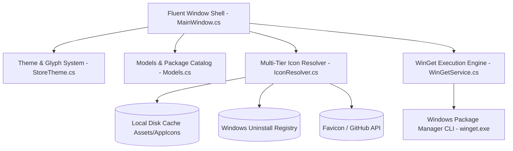
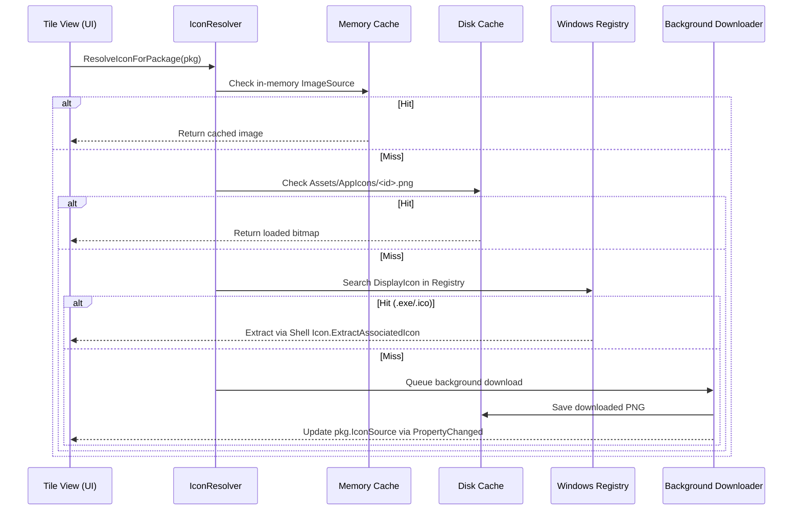

# Architecture & Reverse-Engineering Technical Specification

This document details the internal design, reverse-engineering methodology, and system mechanics behind **WinGetStore**.

---

## 1. High-Level Architecture

WinGetStore is structured into five decoupled layers:



### Component Summary

| Component | File | Responsibility |
|---|---|---|
| **Shell & UI** | `MainWindow.cs` | Frameless custom chrome window, navigation rail, responsive cards, PDP views, Win32 hooks. |
| **Theme Engine** | `StoreTheme.cs` | Light/Dark color palettes extracted from Store `.xbf` binaries, Private Use Area font glyph maps. |
| **Icon Pipeline** | `IconResolver.cs` | 4-tier icon resolution: memory cache, disk cache, registry inspection, background web fetch. |
| **Service Layer** | `WinGetService.cs` | Async process runner, fixed column-boundary parser, locale normalization, live stream parsing. |
| **Data Models** | `Models.cs` | `PackageItem`, `InstallTaskItem`, `CuratedCatalog` with INotifyPropertyChanged bindings. |
| **Entry Point** | `Program.cs` | DPI awareness bootstrapping, `--self-test` parser tests, `--ui-smoke-test` layout validation. |

---

## 2. Reverse Engineering the Official Microsoft Store

The application was reconstructed by reverse-engineering the official Microsoft Store UWP package on Windows 10:
`C:\Program Files\WindowsApps\Microsoft.WindowsStore_22608.1401.7.0_x64__8wekyb3d8bbwe`

### 2.1 Binary & Assembly Inspection (REA)
Using **REA** (Reverse Engineer Anything), we inspected:
1. `WinStore.App.dll`: Identified core navigation controllers, view model contracts, and view mappings.
2. `Microsoft.Management.Deployment.winmd`: Analyzed official WinGet COM interfaces and verified compatibility with `winget.exe` CLI outputs.
3. `WinStore.Tasks.winmd`: Examined background task queuing and notification mechanisms.

### 2.2 XBF Binary Resource Decompilation
We extracted string tables and visual token hierarchies from compiled XBF assets in `WinStore.Resources.pri` and `Themes/`:
- **Color Palettes**: Extracted from `Themes\Dark.xbf` and `Themes\Light.xbf`.
  - Window background: `#1A1A1A` (Dark), `#F0F2F5` (Light)
  - Content surface: `#212121` (Dark), `#F9F9FB` (Light)
  - Card background: `#2B2B2B` (Dark), `#FFFFFF` (Light)
  - Card hover: `#333333` (Dark), `#F3F4F6` (Light)
  - Accent brush: `#0078D4` (Dark), `#0067C0` (Light)
- **Component Layouts**:
  - `CompactProductCard.xbf`: Card dimensions (345x148), rounded corners (8px), padding (16,14).
  - `ImmersiveProductIdentity.xbf`: Hero banner layout, 84px icon tile, two-column responsive split.
  - `SearchPageV2Layout.xbf`: Header search bar with integrated clear and submit glyph actions.
- **Icon Glyphs**:
  Extracted glyph mappings from `Themes\Icons.xbf` mapped to `StoreIcons.ttf` (`Store Fluent Icons`) and `StorMDL2.ttf`:
  - `\uE72B`: Back navigation arrow
  - `\uE721`: Search lens
  - `\uE72C`: Refresh / sync
  - `\uE896`: Download / Install
  - `\uE8F1`: Library
  - `\uE80F`: Home
  - `\uE895`: Updates
  - `\uE713`: Settings

### 2.3 Elimination of Bloat & Tracking
By controlling the complete reconstruction, the following components present in the official store were deliberately omitted:
- `TileAdsBadge.xbf` (Promoted advertising badges)
- `PromotionalBar.xbf` (Sponsor banners)
- `UpsellModule.xbf` (Product upselling prompts)
- `GamePassHeroUnitModule.xbf` & `Microsoft365HeroUnitModule.xbf` (Subscription advertisements)
- `AIHub` (Copilot / AI upsell sections)
- `MeControl` / `PersonPicture` / `XboxAuthManager` (Forced Microsoft Account authentication)

---

## 3. Win32 Window Management & DPI Mechanics

Modern WPF applications with borderless custom window chrome (`WindowStyle.None` and `WindowChrome`) suffer from a notorious Windows 10 bug when maximized: the window frame expands by 8 pixels in all directions (`-8, -8`) into adjacent screens or under the taskbar.

### 3.1 WM_GETMINMAXINFO Handling
WinGetStore intercepts `WM_GETMINMAXINFO` (`0x0024`) through a native Win32 message hook installed in `OnWindowSourceInitialized`:

```csharp
private static void WmGetMinMaxInfo(IntPtr hwnd, IntPtr lParam)
{
    MINMAXINFO mmi = (MINMAXINFO)Marshal.PtrToStructure(lParam, typeof(MINMAXINFO));
    IntPtr monitor = MonitorFromWindow(hwnd, MONITOR_DEFAULTTONEAREST);
    if (monitor != IntPtr.Zero)
    {
        MONITORINFO monitorInfo = new MONITORINFO();
        monitorInfo.cbSize = Marshal.SizeOf(typeof(MONITORINFO));
        if (GetMonitorInfo(monitor, ref monitorInfo))
        {
            RECT rcWorkArea = monitorInfo.rcWork;
            RECT rcMonitorArea = monitorInfo.rcMonitor;
            mmi.ptMaxPosition.x = Math.Abs(rcWorkArea.left - rcMonitorArea.left);
            mmi.ptMaxPosition.y = Math.Abs(rcWorkArea.top - rcMonitorArea.top);
            mmi.ptMaxSize.x = Math.Abs(rcWorkArea.right - rcWorkArea.left);
            mmi.ptMaxSize.y = Math.Abs(rcWorkArea.bottom - rcWorkArea.top);
        }
    }
    Marshal.StructureToPtr(mmi, lParam, true);
}
```

### 3.2 Dynamic Visual Adjustments
When the window transitions between `Normal` and `Maximized`:
- Corner radius is toggled between `8px` (floating) and `0px` (docked).
- Resize border thickness drops to `0px` when maximized to prevent invisible hit-test padding.
- The titlebar caption button dynamically swaps glyphs (`\uE922` Maximize vs `\uE923` Restore).
- Window drag handling allows seamless drag-to-restore when dragging down from the maximized title bar.

---

## 4. Multi-Tier Icon Resolution Strategy

To provide rich visual fidelity without depending on proprietary Microsoft CDN store tokens, `IconResolver.cs` implements an asynchronous four-tier pipeline:



1. **Tier 1 (Memory)**: Fast `ConcurrentDictionary<string, ImageSource>` lookup.
2. **Tier 2 (Disk Cache)**: Local file existence check in `Assets\AppIcons\<PackageId>.png`.
3. **Tier 3 (Local Registry Extraction)**: Scans Windows Uninstall registry keys (`HKLM` and `HKCU` `Software\Microsoft\Windows\CurrentVersion\Uninstall`). Extracts native 32-bit high-resolution icons directly from the application's executable via `System.Drawing.Icon.ExtractAssociatedIcon` and converts it to a WPF `BitmapSource`.
4. **Tier 4 (Async Web Fetch)**: Resolves official high-resolution publisher icons using Google Favicon V2 and GitHub organization avatars, saving directly to disk cache.

---

## 5. WinGet CLI Orchestration & Locale Normalization

WinGet CLI outputs tables with fixed column alignment. Because user systems can have different display languages (e.g., English, Portuguese, Spanish, German), `WinGetService.ParseTableOutput` detects column boundaries dynamically rather than relying on hardcoded English column headers:

- Identifies separator line (`--------`) to map exact string indices.
- Inspects header tokens with regular expressions to map `Name`, `ID`, `Version`, `Available`, and `Source` across language variations (`ID` / `Id`, `Version` / `Versão`, `Available` / `Disponível`, `Source` / `Origem`).
- Strips non-breaking spaces (`\u00A0`) common in localized Windows terminal output.
- Captures live stdout/stderr streams to provide real-time installation logs directly in the UI.
