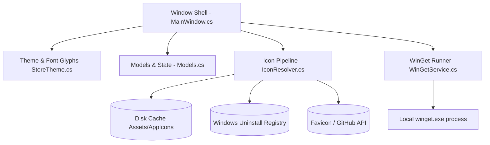
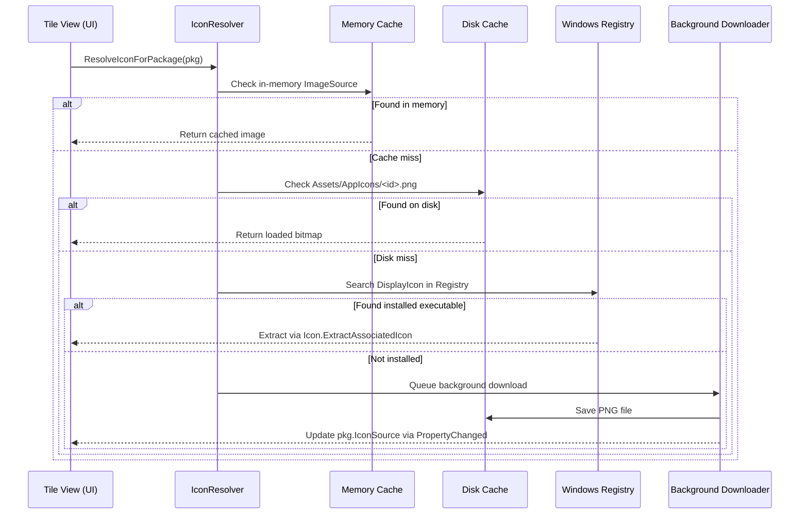

# Architecture and reverse engineering notes

Technical notes on the reverse engineering work, UI reconstruction, and system integration behind WinGetStore.

---

## 1. System design

WinGetStore is divided into five parts:



### Components

| Part | File | What it handles |
|---|---|---|
| **Shell & UI** | `MainWindow.cs` | Borderless window, custom title bar, sidebar navigation, product cards, details page, Win32 window hooks. |
| **Theme & Glyphs** | `StoreTheme.cs` | Light and dark palettes extracted from Store `.xbf` files, Private Use Area glyph mappings for Store fonts. |
| **Icon Pipeline** | `IconResolver.cs` | Four-tier icon lookup: in-memory cache, local disk files, registry scan, background web fetch. |
| **WinGet Service** | `WinGetService.cs` | Async execution of `winget.exe`, column-aligned table output parser, locale normalization, streaming terminal lines. |
| **Models** | `Models.cs` | `PackageItem`, `InstallTaskItem`, and default catalog entries with `INotifyPropertyChanged` bindings. |
| **Entry Point** | `Program.cs` | High-DPI declaration, `--self-test` parser check, `--ui-smoke-test` layout validation. |

---

## 2. Reverse engineering the Microsoft Store

The application was built by analyzing the installed Microsoft Store package on Windows 10:
`C:\Program Files\WindowsApps\Microsoft.WindowsStore_22608.1401.7.0_x64__8wekyb3d8bbwe`

### 2.1 Binary and assembly analysis
Using REA, we inspected three core assemblies:
1. `WinStore.App.dll`: Located view models, page contracts, and navigation controllers.
2. `Microsoft.Management.Deployment.winmd`: Examined the Store's internal WinGet COM interface bindings to ensure parity with the CLI.
3. `WinStore.Tasks.winmd`: Reviewed background update and task worker patterns.

### 2.2 XBF resource inspection
We dumped string tables and visual property structures from compiled XBF files in the Store package:
- **Color tokens**: Extracted from `Themes\Dark.xbf` and `Themes\Light.xbf`.
  - Window background: `#1A1A1A` (Dark), `#F0F2F5` (Light)
  - Content surface: `#212121` (Dark), `#F9F9FB` (Light)
  - Card background: `#2B2B2B` (Dark), `#FFFFFF` (Light)
  - Card hover: `#333333` (Dark), `#F3F4F6` (Light)
  - Accent color: `#0078D4` (Dark), `#0067C0` (Light)
- **Card and page layouts**:
  - `CompactProductCard.xbf`: Card dimensions (345x148), 8px corner radius, internal padding.
  - `ImmersiveProductIdentity.xbf`: Hero banner layout, 84px icon tile, two-column split for description and metadata.
  - `SearchPageV2Layout.xbf`: Header search bar with clear button and enter key triggers.
- **Icon glyphs**:
  Extracted glyph mappings from `Themes\Icons.xbf` corresponding to `StoreIcons.ttf` (`Store Fluent Icons`) and `StorMDL2.ttf`:
  - `\uE72B`: Back navigation arrow
  - `\uE721`: Search magnifying glass
  - `\uE72C`: Refresh / sync arrow
  - `\uE896`: Download / install tray
  - `\uE8F1`: Library icon
  - `\uE80F`: Home icon
  - `\uE895`: Updates download icon
  - `\uE713`: Settings gear

### 2.3 Dropping bloat and tracking modules
Because the UI was reconstructed from source rather than hooked into runtime assemblies, we deliberately discarded all advertising and tracking components:
- `TileAdsBadge.xbf` (ad badges on tiles)
- `PromotionalBar.xbf` (sponsored banners)
- `UpsellModule.xbf` (upselling popups)
- `GamePassHeroUnitModule.xbf` and `Microsoft365HeroUnitModule.xbf` (subscription ads)
- `AIHub` (Copilot / AI promotional sections)
- `MeControl`, `PersonPicture`, and `XboxAuthManager` (forced Microsoft account login)

---

## 3. Window management and DPI fixes

Custom borderless windows in WPF (`WindowStyle.None` paired with `WindowChrome`) have a long-standing issue in Windows 10: when maximized, Windows expands the window by 8 pixels in every direction (`-8, -8`) to hide the standard window borders. For custom chrome apps, this pushes title bars, search inputs, and navigation buttons off-screen or underneath the taskbar.

### 3.1 WM_GETMINMAXINFO hook
To fix this, WinGetStore intercepts the native `WM_GETMINMAXINFO` (`0x0024`) message through an `HwndSource` hook initialized during `SourceInitialized`:

```csharp
private static void WmGetMinMaxInfo(IntPtr hwnd, IntPtr lParam)
{
    MINMAXINFO mmi = (MINMAXINFO)Marshal.PtrToStructure(lParam, typeof(MINMAXINFO));
    IntPtr monitor = MonitorFromWindow(hwnd, MONITOR_DEFAULTTONEAREST);
    if (monitor != IntPtr.Zero)
    {
        MONITORINFO monitorInfo = new MONITORINFO();
        monitorInfo.cbSize = Marshal.SizeOf(typeof(MONITORINFO));
        if (GetMonitorInfo(monitor, ref monitorInfo))
        {
            RECT rcWorkArea = monitorInfo.rcWork;
            RECT rcMonitorArea = monitorInfo.rcMonitor;
            mmi.ptMaxPosition.x = Math.Abs(rcWorkArea.left - rcMonitorArea.left);
            mmi.ptMaxPosition.y = Math.Abs(rcWorkArea.top - rcMonitorArea.top);
            mmi.ptMaxSize.x = Math.Abs(rcWorkArea.right - rcWorkArea.left);
            mmi.ptMaxSize.y = Math.Abs(rcWorkArea.bottom - rcWorkArea.top);
        }
    }
    Marshal.StructureToPtr(mmi, lParam, true);
}
```

### 3.2 Visual state updates
When switching between normal and maximized states:
- Corner radius changes between `8px` (floating) and `0px` (docked).
- Border resize thickness is set to `0px` when maximized to prevent unwanted hit-testing margins.
- Title bar caption buttons swap between `\uE922` (Maximize) and `\uE923` (Restore).
- The mouse drag handler detects when a user pulls down on a maximized title bar, restoring the window and repositioning it under the cursor smoothly.

---

## 4. Icon resolution pipeline

Without depending on Microsoft Store CDN access tokens, `IconResolver.cs` uses a four-step pipeline to find icons:



1. **Memory cache**: Fast check against `ConcurrentDictionary<string, ImageSource>`.
2. **Local disk**: Looks for pre-packaged or previously cached PNGs in `Assets\AppIcons\<PackageId>.png`.
3. **Windows Registry**: Scans `HKLM` and `HKCU` uninstall keys for installed software. If a valid executable path is found in `DisplayIcon`, extracts the high-resolution application icon via `System.Drawing.Icon.ExtractAssociatedIcon` and converts it into a WPF `BitmapSource`.
4. **Background web download**: If an app is neither cached nor installed locally, queues a background request to fetch publisher icons using Google's Favicon V2 service and GitHub organization avatars, caching the file to disk.

---

## 5. WinGet CLI parsing

WinGet outputs tabular data where column positions shift depending on installed versions and package IDs. Additionally, system languages alter column headers (e.g., `Name` vs `Nome`, `Version` vs `Versão`, `Available` vs `Disponível`).

`WinGetService.ParseTableOutput` addresses this by:
- Locating the hyphen divider line (`---------`) to measure exact character boundaries for columns.
- Scanning header words with regular expressions to map field indices regardless of whether headers are English, Portuguese, or Spanish.
- Stripping non-breaking spaces (`\u00A0`) produced by some localized Windows command prompts.
- Piping process stdout/stderr directly to an event handler so the UI can show live progress without hanging.
